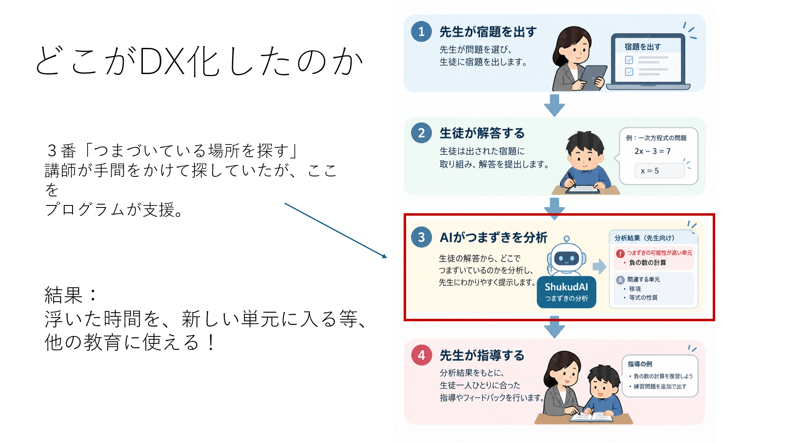
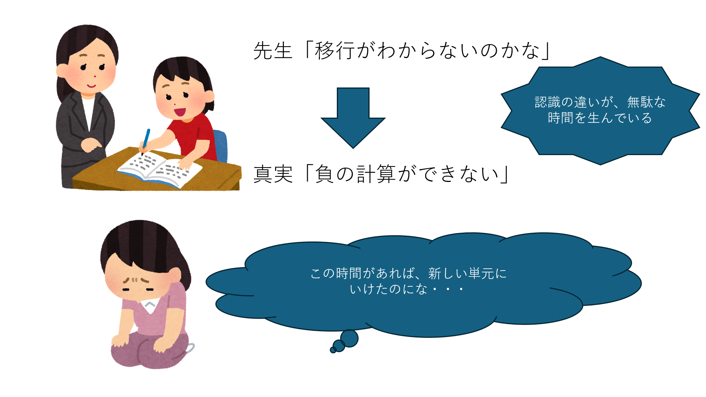

# wakaranAI
### 「つまずきを探す時間」を、「可能性を伸ばす時間」へ。

**テーマ：** 塾講師の指導DX × Tech

<!--
タイトル画像の挿入予定箇所
発表スライドの表紙を、横長16:9の画像として掲載する想定です。
保存先の例：docs/images/title.png
画像を用意した後、次の行をこのコメントの外へ移してください。

-->

## 塾講師に対するＤＸの必要性

少子高齢化が進む社会で、これからを生きる子どもたち一人あたりが背負う負担は大きくなります。私は、そんな未来の世界でも押しつぶされない人材になるには、「教育の質」が大事だと考えています。

一方、教育の多くを担う塾の指導現場には、大学生を含む、指導経験の浅い講師が多いのが現状です。
結果、授業時間が足りず、試験までに範囲を終わらせられなかったり、生徒の「本当にわからないところ」に対した適切な説明ができないことが多いです。

したがって、「指導経験が浅くても、いい指導をする」ためには、先生側を支援するサービスが必要だと考えたので、このアプリを作成しました。


**wakaranAIは、指導経験の浅い塾講師が、生徒のつまずきを確かめ、指導を考えるための講師支援アプリです。**

## 概要
塾講師に生徒の「分からない箇所の本質」を伝えるアプリです。
生徒が回答を間違えた宿題に対し、前提知識を確かめる質問を出題。生徒の回答とつまずき候補を整理し、「生徒が本当はどの部分に困っているのか」講師による確認・指導、次の宿題での復習につなげます。



## 目標
**原因を探すための情報を整理し、生徒との対話や、その子に合った説明に時間を使えるようにすること**を目指しています。
AIが原因を確定したり、講師の指導を代替したりするものではありません。


## アプリ・デモ動画

**[公開アプリを開く](https://tka-2611.onrender.com)**

**デモ動画：掲載準備中**

現在の学習記録はブラウザ内に保存されます。別のスマートフォンやパソコンへの記録共有は未実装です。
Renderの無料サービスは、一定時間アクセスがないと休止するため、最初の表示に時間がかかる場合があります。[Render公式資料](https://render.com/docs/free)

## 開発のきっかけ


私が塾講師をしていたとき、一次方程式を何度説明しても解けない生徒がいました。

移項が分からないのではないかと考えて何度も説明したのですが、いつまで経っても正解できません。確認すると、生徒は「一次方程式」ではなく、その前提となる「負の数の計算」につまずいていました。

表面的な誤答だけでは、どの知識で困っているのか分かりません。原因を確かめるために、一つずつ質問を重ねる必要がありました。

**もっと早く気づければ、生徒との対話や、その子に合った説明に時間を使えたのではないか。**

この経験が、wakaranAIの出発点です。

## 解決したい課題

主なターゲットは、**指導経験の浅い塾講師**です。


**課題１：** 原因特定に時間がかかる
現在は、生徒が問題を間違えたとき、講師は「今の単元が分からないのか」「前に習った計算につまずいているのか」を、一人ずつ確かめる必要があります。どの知識でつまずいたのか、一人ずつ確認する負担が大きいです。

**課題２：** 生徒に合った指導が難しい
原因が分からなければ、同じ説明を繰り返してしまう。また、生徒自身も、どこが分からないのか説明できない場合があり、時間が足りないだけではなく、「そもそも分からない箇所にたいする適切な説明ができない」ことがあります。

これらの課題を解決することで、初心者塾講師の無駄な手間を省いて、より質の高い教育をできると考えています。

| 困っていること | 今回の取り組み |
| --- | --- |
| 最終的な答えだけでは、つまずいた箇所が分かりにくい | 前提知識を確認する小さな質問を出す |
| 生徒の説明には、さまざまな言い回しがある | 自由記述の意味をAIで分析する |
| 講師が生徒ごとの確認事項を整理する必要がある | スキル別・生徒別の候補と回答原文を表示する |
| 説明した後に、解けるようになったか確かめたい | 指導記録を起点に、次の宿題へ復習を割り当てる |

つまずきを把握する難しさ自体は、既知の教育課題です。本作では、**回答を集めるところから、講師の確認・指導後の再確認までをつなぐ手順**を具体化しました。


## 利用の流れ

**宿題 → 前提知識の確認 → 講師が確認・指導 → 次の宿題で復習 → 再確認**

1. **講師が宿題を設定する**  
   単元、問題数、提出期限、対象生徒を選びます。

2. **生徒が宿題を解く**  
   正解した問題は終了します。不正解や未解答の場合は、前提知識を確かめる質問へ進みます。

3. **回答から確認候補を整理する**  
   数値・対応する数式はプログラムで判定し、自分の言葉で書く説明はAIで分析します。

4. **提出後、講師が根拠を確認する**  
   スキル別の人数、生徒別の候補、回答原文を確認できます。候補は、本人と話すときの手がかりです。

5. **講師が指導を記録する**  
   本人と確認して指導し、必要に応じてメモを残して「指導済み」にします。

6. **次の宿題に復習を組み込む**  
   条件を満たす生徒には、通常問題の一部を個別の復習2問に置き換えます。

7. **復習結果を記録する**  
   復習2問に正解して提出すると、「定着確認」に更新します。

### 状態の意味

| 状態 | 意味 |
| --- | --- |
| 要指導（確認候補） | 講師が本人と確認したい内容がある |
| 指導済み・要再確認 | 講師が指導を記録した。復習による再確認はこれから |
| 定着確認 | 対象の復習2問に正解し、宿題を提出した |

**「指導済み」を押すだけでは「定着確認」になりません。**

また、「定着確認」は本プロトタイプの条件を満たした記録です。長期間にわたる理解や、別の場面で応用できることを実証するものではありません。


<details>
<summary>復習2問を割り当てる条件</summary>

- 「指導済み・要再確認」のスキルが対象です。
- 指導日より後の提出期限で、新しい宿題を設定した場合に割り当てます。
- 1回の宿題につき1スキル、2問です。
- 複数の対象がある場合は、指導日時が古いものを優先します。
- 合計問題数は増やしません。10問なら通常8問＋復習2問です。
- 未提出の宿題に割り当て済みの復習は、重複して配布しません。
- 復習2問が両方正解で、提出すると「定着確認」になります。
- 復習で確認できなかった場合は、再び確認候補として扱います。
- 新たなつまずきが記録された場合、古い復習結果だけで新しい課題を解決済みにはしません。

将来の提出期限を設定した宿題も、すぐに解けます。実際に一定の日数が経過するまで回答を制限する機能はありません。

講師画面には、スキルに応じた練習問題の提案もあります。こちらは用意済みの問題・解答・解説を参照する機能で、宿題に自動で組み込む復習2問とは別です。AIによる問題生成ではありません。

</details>

## なぜChatGPTだけではなく、専用アプリなのか

通常のチャットでも、生徒の回答を分析したり、説明を考えたりできます。

wakaranAIが取り組むのは、AIモデルの賢さだけではなく、**講師が日常の指導で扱う操作と記録のつながり**です。

- どの宿題に対する回答なのか。
- どの回答を根拠に、何を確認したいのか。
- 講師が確認・指導したか。
- 次にどの復習を出すか。
- 指導後に、その問題を解けたか。

これらを関連付けて扱い、講師が毎回チャットへの説明や記録の整理を一から行う負担を減らすことを目指しています。

**少ない操作で活用できることは設計目標です。** 現時点で、一般的なチャット利用より便利であることや、作業時間が短縮することを測定した結果はありません。

## 既存サービスとの違い

私たちは、生徒の自主性だけに頼らず、先生からの宿題と対面指導に組み込むことを重視しています。

| 比較 | 生徒目線の流れ | 想定する課題・狙い |
| --- | --- | --- |
| 生徒がプログラムだけで学ぶ場合 | プログラム → 生徒 | 「強制力」がないため、取り組むかどうかが本人の自主性に左右される。また、AIの説明が正しいか不安を感じたり、説明だけでは納得できなかったりする場合がある。 |
| wakaranAI | プログラム → 先生 → 生徒 | 先生から出される宿題なので、「やらなきゃ怒られる」と、強制力が働く。また、先生が分析候補を確認し、対面で疑問に答えながら指導することで、納得して学べることを目指す。 |

このことから、このアプリの導入は、先生のDX支援のみならず、生徒目線においてもよい影響を与えることが期待されます。

**宿題はデジタルで、指導は人間の塾講師から。**
つまずきの分析を、先生との対話と指導につなげます。

※ 本表は学習の流れの比較であり、既存サービスすべてが「プログラム → 生徒」の形であることを示すものではありません。

## プログラム・AI・講師の役割分担

| 担当 | 役割 | この分担にする理由 |
| --- | --- | --- |
| プログラム | 数値・対応する数式の判定、宿題管理、状態管理、復習の割り当て | 正解や処理条件が明確なため |
| AI | 生徒が自分の言葉で書いた説明の分析 | 多様な言い回しを、キーワード一致だけで扱うことが難しいため |
| 講師 | 分析候補を本人と確かめ、生徒に合う指導を行う | 回答だけでは分からない事情も、対話で確認するため |

通常モードの分析質問・復習問題にある自由記述では、**GroqをAPI提供サービスとして、`openai/gpt-oss-120b`を使用モデルとして利用**しています。[Groqのモデル情報](https://console.groq.com/docs/model/openai/gpt-oss-120b)

数値問題や対応する数式、発表用デモ、「まだ分からない」の申告ではAIを呼び出しません。AIの利用を必要な説明文の分析に絞り、不要なAPI通信と利用料を抑える設計です。削減額は未測定です。

「まだ分からない」は、生徒本人の申告として記録します。AIによる推定とは区別します。

## 技術構成

```text
ブラウザ
  ├─ HTML / CSS / JavaScript：表示・操作
  ├─ engine.js：採点・宿題・指導後の状態管理
  └─ localStorage：このブラウザの学習記録を保存
          │
          │ 通常モードの自由記述のみ
          ▼
Node.jsサーバー（server.cjs / Render）
  ├─ 問題と判定基準の組み立て
  ├─ 入力・AI応答の検査
  └─ サーバー側のAPIキーで通信
          │
          ▼
Groq API
  └─ openai/gpt-oss-120b
```

| ファイル | 主な役割 |
| --- | --- |
| `wakaranai/index.html` | 画面の入口 |
| `wakaranai/style.css` | デザイン・レイアウト |
| `wakaranai/app.js` | 画面操作、API通信、ブラウザ内保存 |
| `wakaranai/engine.js` | 問題、採点、確認候補、宿題・復習の管理 |
| `wakaranai/server.cjs` | ファイル配信、Groq APIへの中継 |
| `wakaranai/test.cjs` | 学習処理・API関連のテスト |
| `wakaranai/test-public.cjs` | 公開用サーバーのテスト |
| `wakaranai/package.json` | Node.jsの要件・実行コマンド |

### AI結果をそのまま確定情報にしない仕組み

サーバーが、問題に対応する判定基準と回答を組み立ててAIへ送信します。AIからは、判定候補、理由、回答中の根拠となる引用を受け取ります。

受信後は、形式、値の種類、文字数、引用が実際の回答に含まれるかを検査してから記録に反映します。ただし、形式検査によって分析内容の正しさまで保証できるわけではありません。

通信失敗や時間切れの場合は、回答を残して再送できるようにし、**通信失敗を生徒の誤答として記録しません。**

APIキーはサーバー側の環境変数で管理し、ブラウザへ配信するファイルに含めない構成です。

## 現在できること・制約・検証状況

### 実装していること

- 一次方程式・連立方程式の宿題設定と回答。
- 誤答・未解答に対する、用意済みの分析質問の出題。
- 通常モードの自由記述に対するGroq API連携。
- スキル別・生徒別の確認候補と、回答原文の表示。
- 講師の指導メモと「指導済み」の記録。
- 条件に応じた復習2問の割り当てと、提出後の状態更新。
- スキル別の練習問題・解答・解説の提案。
- ブラウザ内での保存と、APIを使わない発表用デモ。
- Render上での公開。

### 現在の制約

| 項目 | 現在の範囲 |
| --- | --- |
| 教材 | 一次方程式・連立方程式を中心とする、用意済みの問題 |
| 分析質問 | あらかじめ定義した質問。AIが自由に質問を生成する構成ではない |
| 数式判定 | 対応した記法のみ。任意の数式の同値性判定ではない |
| AI分析 | 確認候補。誤判定や見落としの可能性がある |
| 生徒・講師の入口 | 画面の切り替え。ログイン認証ではない |
| 学習記録 | ブラウザ内保存。バックエンドDB・別端末間の共有は未実装 |
| データ保持 | ブラウザの保存データを削除すると記録も消える |
| 効果 | 指導時間の短縮、教育効果、長期的な定着は未検証 |

**公開URLからアプリを使えることと、生徒・講師の別端末間で記録を共有できることは別です。** 現在は、同じブラウザ内で一連の操作を体験する構成です。

試用には架空の回答を用い、実在する子どもの氏名や個人情報は入力しないでください。


## 今後の展望と検証計画

まず、指導経験の浅い塾講師に試用してもらい、情報整理が実際の指導に役立つかを確かめたいです。

| 検証したいこと | 検証案 |
| --- | --- |
| 原因の確認に必要な時間 | 通常の答案確認と本作を使う場合を、同程度の課題で比較する |
| 分析候補の妥当性 | 講師が回答原文・本人との対話をもとに確認し、候補との一致や違いを記録する |
| 見落とし・誤った候補 | 正しい言い換え、曖昧な説明、複数の誤りを含む回答などで評価する |
| 導入による追加負担 | 宿題設定、説明文入力、候補確認、指導記録にかかる操作と時間を測る |
| 指導後の再確認 | 復習直後だけでなく、期間を空けた別問題で解けるかを確かめる |
| 運用費用 | 分析回数、応答時間、入出力トークン量、API料金を記録する |

いずれも今後の検証計画であり、実施済みの成果ではありません。

利用者を増やすには、認証、権限管理、別端末間の共有、データ保護、バックアップが必要です。教材を増やす場合は、問題だけでなく、前提知識の関係、分析質問、判定基準、復習問題の整備・確認も必要になります。

現在はAPI通信の同時実行数や回数を制限していますが、サーバー内の一時的な管理です。多数の利用者への対応や、厳密な費用上限管理は今後の課題です。

また、導入負担はAPI料金だけではありません。**講師が宿題を設定し、候補を読み、本人と確認して記録する手間も含めて評価します。**

## ローカルでの起動方法

### 必要なもの

- **Node.js 24.x**：`package.json`の指定に合わせます。
- 通常モードでAI分析を使う場合：Groq APIキー。
- ブラウザ。

外部のnpm依存ライブラリはなく、現在の構成では依存ライブラリのインストールは不要です。

### 起動する

リポジトリを取得し、`package.json`と`server.cjs`がある`wakaranai`フォルダへ移動します。

```powershell
cd wakaranai
node --version
```

PowerShellで、APIキーを環境変数に設定します。以下の値は説明用です。実際には自分のキーへ置き換えてください。

```powershell
$env:GROQ_API_KEY = "ここを自分のGroq APIキーに置き換える"
npm start
```

起動後、ブラウザで次を開きます。

[http://127.0.0.1:4173](http://127.0.0.1:4173)

`index.html`を直接ダブルクリックする方法ではなく、サーバーのURLから開いてください。

終了するときは、起動したターミナルで`Ctrl+C`を押します。上記の環境変数は、そのPowerShellのセッションに設定されます。

APIキーをソースコード、README、スクリーンショット、GitHubへ掲載しないでください。

<details>
<summary>接続確認・テスト・公開時の設定</summary>

### 接続確認

サーバー起動中に、次のURLを開きます。

- [http://127.0.0.1:4173/healthz](http://127.0.0.1:4173/healthz)：サーバーの応答確認。
- [http://127.0.0.1:4173/api/status](http://127.0.0.1:4173/api/status)：APIキーの設定状態などの確認。

`keyConfigured`が`true`でも、キーの有効性やGroqとの通信成功までは保証しません。

実APIの確認には、通常モードで自由記述を送信します。例えば、等式の両辺へ同じ数を足してよい理由として、次のような架空の回答を入力します。

> 左右が同じ値なので、両方に同じ数を足しても等しさが保たれるから。

分析が返ることと、その分析が妥当であることを分けて確認してください。

### 自動テスト

`wakaranai`フォルダで実行します。

```powershell
npm test
```

実行されるテストは次の2つです。

```text
node test.cjs
node test-public.cjs
```

これらは実際のGroq APIによる日本語判定精度を測るテストではありません。


### Renderで公開する場合

現在のリポジトリ配置では、主な設定は次のとおりです。

| 設定 | 値 |
| --- | --- |
| Runtime | Node |
| Root Directory | `wakaranai` |
| Build Command | `npm test` |
| Start Command | `npm start` |
| Health Check Path | `/healthz` |
| 環境変数 | `GROQ_API_KEY`に実際のキーを設定 |

Renderが提供する公開URLの環境変数をサーバーが利用します。別の環境で本番起動する場合は、公開URLに合わせた`PUBLIC_ORIGIN`の設定が必要です。

公開先でAPIキーを設定するのは運営者です。アプリを利用する生徒・講師が、それぞれキーを入力する必要はありません。

</details>

## 開発成果と役割分担

現時点では、宿題への回答、確認候補の整理、講師の指導記録、個別復習、再確認までを、一つのアプリで操作できる形にしました。

開発は2人で行っています。担当者ごとの実績と、事前制作・Hack Day期間内・終了後の改善の区分は、整理して追記予定です。

本READMEの「実装していること」は、現在のコード全体を説明したものであり、すべてをHack Day期間内に制作したという意味ではありません。

## 参考資料

外部資料の確認日：2026年10月19日。

- [wakaranAIのソースコード](https://github.com/jphacks/tka_2611)
- [Groq：openai/gpt-oss-120bのモデル情報](https://console.groq.com/docs/model/openai/gpt-oss-120b)
- [Render：無料サービスの仕様と制限](https://render.com/docs/free)
````
